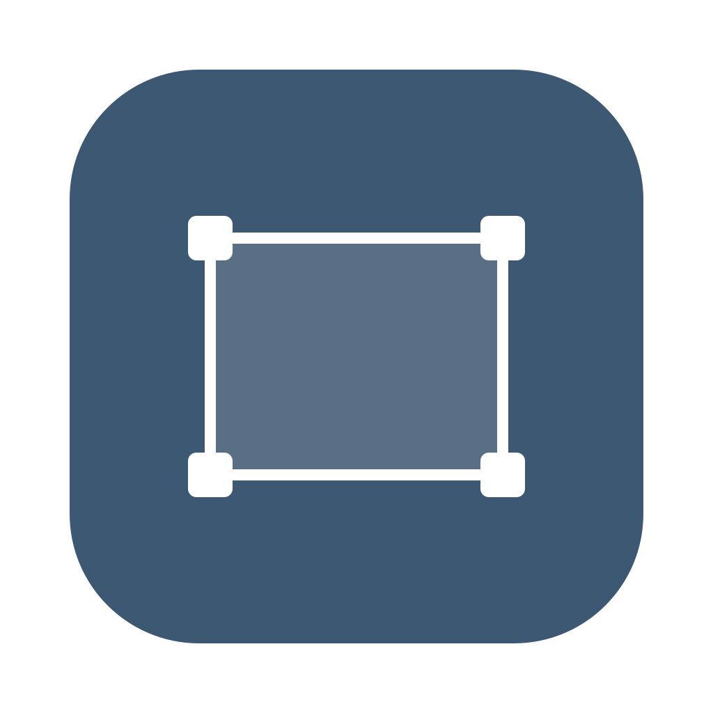
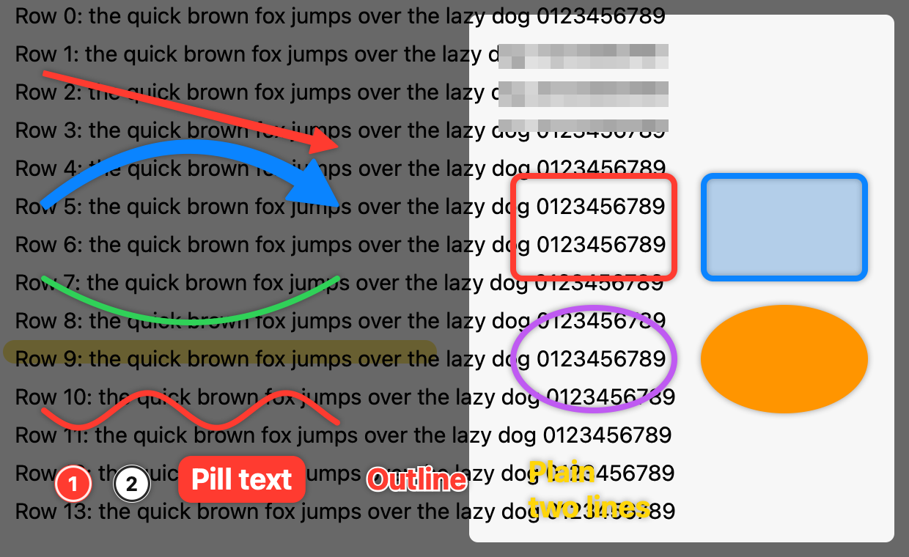

# Floaty

**Screenshots that stay on screen.** Floaty is a small macOS menu bar app: press a shortcut, drag a region, and the capture floats above all your other windows, exactly where you took it. Keep it there as a reference, mark it up, then copy it or drag it wherever it needs to go.

It is built for the moments the built-in tool handles poorly: comparing a design against your build, keeping an error message visible while you fix it, or pointing at something with an arrow before sending it to a teammate.

## What it does

### Capture that feels native
- Press **⇧⌘2** and drag, just like the built-in screenshot tool: same crosshair, live size readout, and Space to reposition the selection.
- The capture appears pixel-for-pixel over the spot it came from, with a short lift animation.

### Floats that stay out of your way
- Floats sit above every window, on every Space, including over full-screen apps.
- They never steal focus. Your typing keeps going to the app you were in until you click a float.
- Keep as many on screen as you like. The focused one lifts on a deeper shadow.
- Hide or bring back all of them with one shortcut.

### Move, resize, see through
- Drag to move. Drag any edge or corner to resize in proportion; hold Shift to stretch or Option to resize from the center.
- Pinch or Cmd-scroll to scale. Press **0** to snap back to original size.
- Press **O** for an opacity slider, handy for overlaying a mockup on the real thing.
- Optional: floats turn slightly see-through, with a blur behind them, while you drag.

### Annotate in place
Press a tool key on a float and start drawing. No separate editor window.

- Arrows and lines, which you can bend into curves
- Rectangles and ellipses, outlined, tinted, or filled
- Text in five styles: plain, drop shadow, outline, and two kinds of label
- Freehand pen and highlighter
- Pixelate to hide sensitive details
- Numbered steps that count up as you click
- Spotlight to dim everything except what matters
- Crop

Every mark stays editable: select it later to move, restyle, or delete it. Each tool remembers the color and size you last used with it, and everything can be undone. The original screenshot is never altered.



### Get it where it needs to go
- **⌘C** copies the image, annotations included, at full Retina resolution.
- **⌥⌘C** copies the file path.
- Drag the file handle on a float straight into Slack, Mail, Finder, or an upload field, or click it to share.
- **⇧⌘S** saves a copy as PNG or JPEG.

### Nothing gets lost
Every capture is saved automatically to `~/Pictures/Floaty`. Closing a float only puts it away. Old captures are cleaned up after 30 days, or whatever period you choose.

## Shortcuts

Anywhere:

| Shortcut | Action |
|---|---|
| ⇧⌘2 | Capture a region |
| ⌥⇧⌘H | Hide or show all floats |

On a focused float:

| Shortcut | Action |
|---|---|
| ⌘C | Copy image |
| ⌥⌘C | Copy file path |
| ⇧⌘S | Save a copy |
| O | Opacity |
| 0 | Original size |
| U or ⌘Z | Undo (add Shift to redo) |
| ⌘, | Settings |
| Esc | Close the float |

Annotation tools:

| Key | Tool | Key | Tool |
|---|---|---|---|
| A | Arrow | P | Pen |
| L | Line | H | Highlighter |
| R | Rectangle | B | Pixelate |
| E | Ellipse | N | Numbered step |
| T | Text | S | Spotlight |
| V | Select and move | C | Crop |

While annotating, `1`–`8` pick a color, `[` and `]` change size, Shift keeps lines at 45° and shapes square, and Delete removes the selected mark. Hover any toolbar button to see its name and key.

## Install

There is no download yet; you build it yourself, which takes about a minute. You need macOS 15.2 or later and Xcode's command line tools (`xcode-select --install`).

```sh
git clone https://github.com/rafaeluna/Floaty.git
cd Floaty
./scripts/setup-signing.sh   # one time
./build.sh
```

`build.sh` builds `build/Floaty.app` and launches it. Look for the viewfinder icon in your menu bar. To keep it around, copy `Floaty.app` into your Applications folder and turn on "Open Floaty at login" in its settings.

The one-time signing step creates a local certificate so macOS remembers the permissions you grant. Without it, you would have to re-approve screen recording after every rebuild.

## Permissions

macOS will ask for these the first time they are needed:

| Permission | Why |
|---|---|
| Screen Recording | Required. This is how any app captures the screen. |
| Pictures folder | To save your captures. You can choose a different folder in settings. |
| Accessibility | Optional. Only used so pinch-to-resize works on floats. |

Floaty has no network code. Nothing you capture leaves your Mac unless you send it somewhere.

## Good to know

- Floaty has no Dock icon. It lives in the menu bar, and its settings open with ⌘, on a focused float or from the menu bar icon.
- It relies on two unofficial macOS calls (for cursor handling and the drag blur), so it is not suited to the Mac App Store.
- Still to come: window and full-screen capture, copying text out of an image, a visual history browser, and customizable shortcuts.

## Contributing

Issues and pull requests are welcome. If you work on the code with an AI coding agent, point it at [AGENTS.md](AGENTS.md), which describes how the project is put together and the pitfalls already found.

## License

MIT. See [LICENSE](LICENSE).
